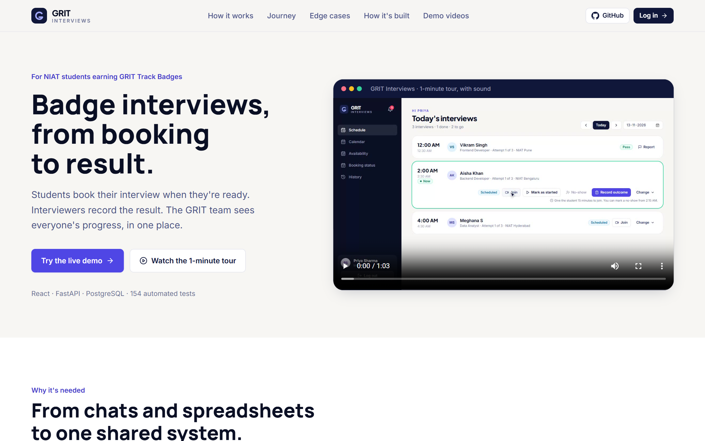
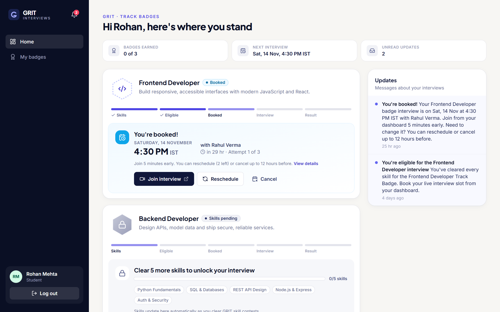
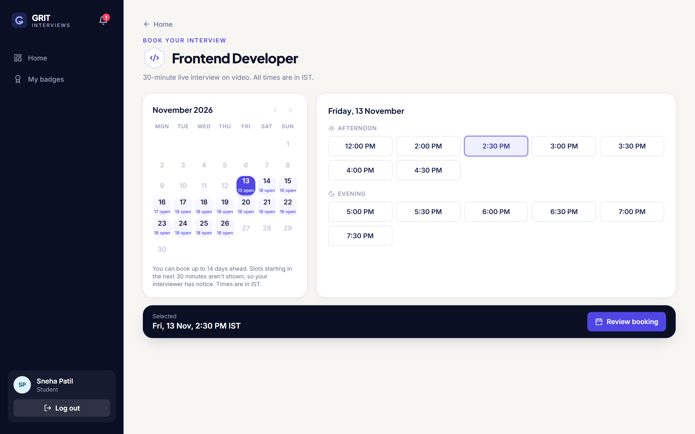
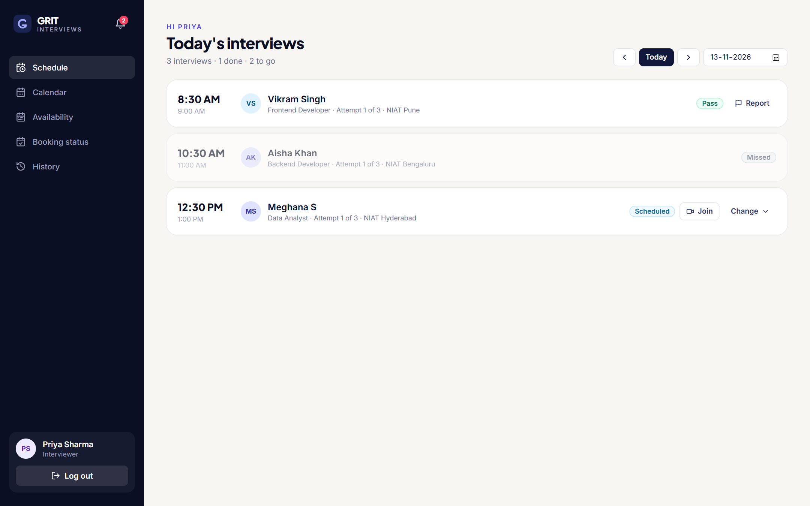
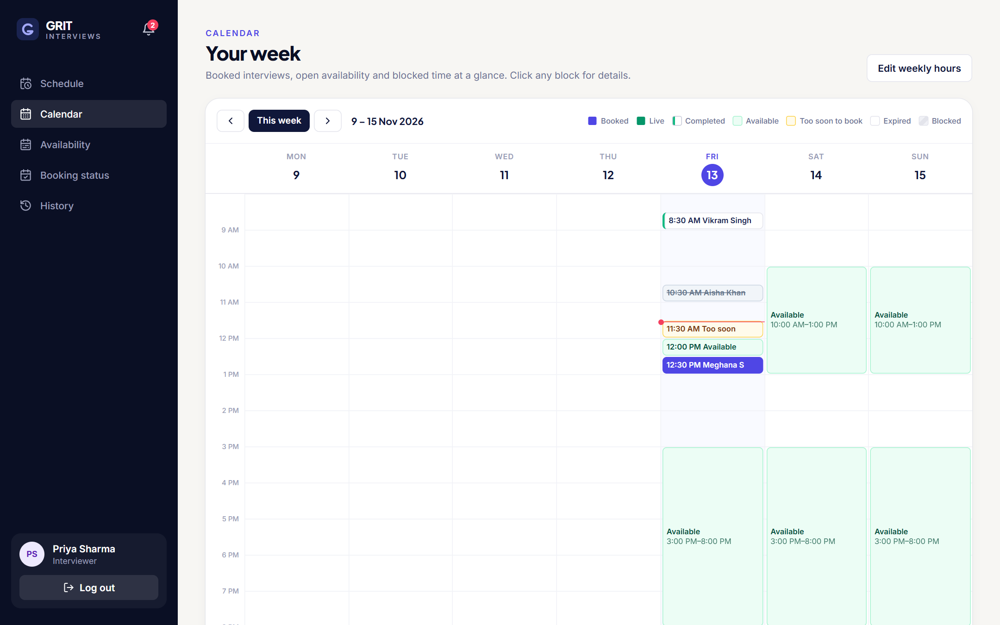
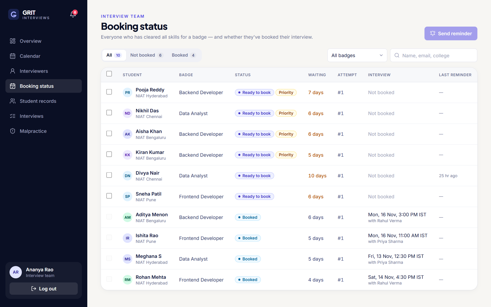
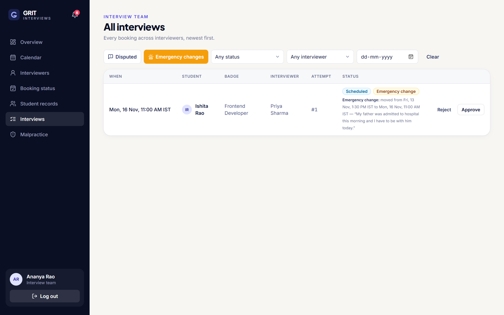
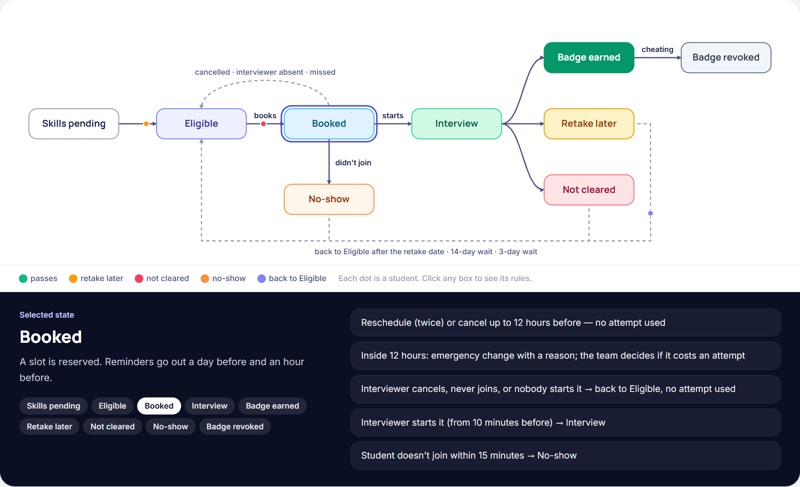
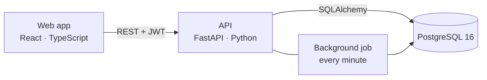
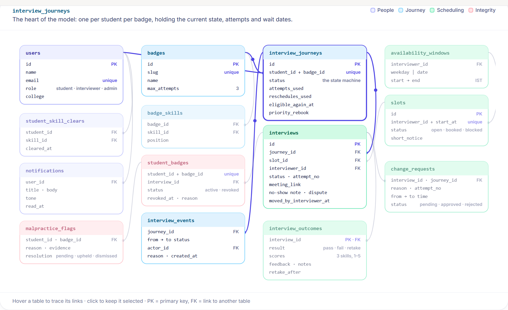

<div align="center">

# GRIT Interviews

**Book, run and record GRIT Track Badge interviews in one place.**

Students book when they're ready. Interviewers record the result. The GRIT team sees everyone's progress.


[Quick start](#quick-start) · [Features](#what-it-does) · [How it works](#how-it-works) · [Architecture](#architecture) · [Design write-up](docs/WRITEUP.md)



</div>

---

## The problem

GRIT students who clear every skill for a Track Badge must pass a live interview to earn it. Without a system, that runs on chats and spreadsheets:

- **Students** don't know when or how to book.
- **Interviewers** track slots, no-shows and results by hand.
- **The team** can't see who is ready but hasn't booked, and has no clean way to revoke a badge if cheating is found later.

GRIT Interviews gives all three one shared, rule-based system.

## What it does

### For students

Booking unlocks the moment the last skill is cleared. One card per badge shows exactly where the student stands: when the interview is, who it's with, what they can still change, and the result with feedback.

<table>
<tr>
<td width="50%"></td>
<td width="50%"></td>
</tr>
<tr>
<td align="center"><sub>Dashboard: one card per badge</sub></td>
<td align="center"><sub>Booking from a 14-day calendar (IST)</sub></td>
</tr>
</table>

- Reschedule twice or cancel up to 12 hours before. Inside 12 hours, make an **emergency change** with a reason for the team to review.
- Report an interviewer who never joined, or dispute an unfair no-show.
- Reminders a day before and an hour before.

### For interviewers

<table>
<tr>
<td width="50%"></td>
<td width="50%"></td>
</tr>
<tr>
<td align="center"><sub>Today's schedule with time-locked actions</sub></td>
<td align="center"><sub>Week calendar of slots and bookings</sub></td>
</tr>
</table>

- Set weekly hours, one-off dates, days off, windows up to midnight, and short-notice slots.
- Record **pass**, **retake later** or **not cleared**, with a 3-skill rubric and feedback.
- Reschedule or cancel an interview, always with a reason the student and team see.

### For the interview team

<table>
<tr>
<td width="50%"></td>
<td width="50%"></td>
</tr>
<tr>
<td align="center"><sub>Who's booked, who isn't, and reminders</sub></td>
<td align="center"><sub>Review emergency changes and disputes</sub></td>
</tr>
</table>

- See every interviewer's calendar and availability.
- Correct skill records and reopen booking early, with the reason in the audit trail.
- **Nullify a badge** for malpractice in one step. Appeals can reinstate it.

## How it works

### The student journey

Every student has one journey per badge. A single state machine is the only code allowed to change its status, and every change is written to an audit trail.



Each student gets **3 attempts** per badge. A retake, or anything that wasn't the student's fault (interviewer absent, interviewer cancelled, nobody started it), doesn't count.

### Interview day

| Time | What unlocks |
|---|---|
| 30 min before | Booking closes (the interviewer can open a slot at short notice) |
| 10 min before | The interviewer can start the interview |
| Start | The result can be recorded |
| +15 min | No-show (interviewer) and "my interviewer hasn't joined" (student) |
| +45 min | If nobody started it, it's marked **missed**, with no attempt used |

### Edge cases

| Situation | What happens |
|---|---|
| Two students pick the same slot | Row locks and a unique index let only one win; the other is asked to pick again |
| A student has a last-minute emergency | The change happens at once; the team approves it (free) or rejects it (counts as an attempt) |
| The interviewer can't make it | Reschedule or cancel with a reason; the student keeps their attempt and is booked first |
| A student is marked absent unfairly | They dispute within 48 hours; the team sees both sides before deciding |
| Cheating is found after a pass | The badge is revoked and the student sees the reason |

The full reasoning is in the **[design write-up](docs/WRITEUP.md)**: states, edge cases, data model and the three key student messages.

## Architecture



- **Every rule lives in the API.** The screens ask the API which actions are allowed and when blocked ones open, so the UI never re-implements a rule.
- **No double bookings.** Booking locks the journey, slot and interview rows. Partial unique indexes are a second guard, tested with five students racing for one slot.
- **Runs on its own.** A background job sends reminders and marks missed interviews. It locks rows with `SKIP LOCKED`, so several API workers can run it safely.

### Data model



Start with `interview_journeys`: one row per student per badge, holding their current state, attempts and wait dates.

## Quick start

The only requirement is **[Docker Desktop](https://www.docker.com/products/docker-desktop/)**. Python, Node and Postgres all run in containers.

```bash
git clone git@github.com:aryanjain1908/Interview-Scheduler.git
cd Interview-Scheduler
```

| Windows | macOS / Linux |
|---|---|
| Double-click `start.bat`, or run `.\start.ps1` | `./start.sh` |

The script:
1. starts Docker Desktop if it isn't running;
2. builds the images on the first run;
3. starts the database, API and web app;
4. waits until they're ready, then opens **http://localhost:5173**.

| Option (Windows / macOS · Linux) | What it does |
|---|---|
| `-Rebuild` / `--rebuild` | Rebuild images, e.g. after changing dependencies |
| `-Reset` / `--reset` | Wipe and reload the demo data |
| `-Test` / `--test` | Run the backend test suite |
| `-Logs` / `--logs` | Follow the logs of all services |
| `-Stop` / `--stop` | Stop everything; add `-Wipe` / `--wipe` to delete the database |

| Service | URL |
|---|---|
| Web app | http://localhost:5173 |
| API docs (Swagger) | http://localhost:8000/docs |
| Postgres | `localhost:5432` (user and password `grit`) |

### Demo accounts

Every account uses the password **`demo1234`**. You can also sign up with any role.

| Account | What you'll see |
|---|---|
| `sneha@grit.demo` | Eligible student, ready to book |
| `rohan@grit.demo` | Booked for tomorrow; can reschedule or cancel |
| `vikram@grit.demo` | Just passed, with the badge on the profile |
| `ishita@grit.demo` | Emergency change waiting for the team |
| `farhan@grit.demo` | Disputed no-show waiting for the team |
| `aditya@grit.demo` | Interviewer moved the interview; free to change it |
| `tanvi@grit.demo` | Badge revoked for malpractice |
| `priya@grit.demo` | Interviewer with interviews today |
| `admin@grit.demo` | Interview team |

> **Try a result right away:** Aisha's interview on Priya's schedule is live when the data is seeded. Record a pass, then log in as `aisha@grit.demo` to see it.

## Demo videos

Four narrated videos, recorded in the real app, play on the home page:

| Video | Length |
|---|---|
| [Product tour](frontend/public/videos/overview.mp4) | 1:03 |
| [For students](frontend/public/videos/student.mp4) | 0:59 |
| [For interviewers](frontend/public/videos/interviewer.mp4) | 0:53 |
| [For the interview team](frontend/public/videos/team.mp4) | 0:43 |

The tooling that records and voices them is in [`tools/video`](tools/video/README.md).

## Tests

```bash
./start.sh --test        # or .\start.ps1 -Test on Windows
```

154 tests run against a real Postgres database. They cover:
- every allowed and refused state transition, plus eligibility and cooldowns;
- booking rules and concurrent booking races;
- interview-day timing, attendance, disputes and reminders;
- emergency changes, interviewer moves and cancels;
- auth and role guards.

## Logging

The API logs with **[loguru](https://github.com/Delgan/loguru)**:
- **Requests:** each request logs one line with its status, duration and a request ID. The same ID is returned in the `X-Request-ID` header.
- **Events:** bookings, results, no-shows and reviews are logged with record IDs only, never names, emails or passwords.

Set `LOG_LEVEL=DEBUG` to see every state change, or `LOG_JSON=true` for JSON lines.

## Project structure

```text
backend/
  app/
    services/   business rules: state machine, booking, interview-day rules, attendance, reviews
    routers/    thin HTTP layer: validate, call a service, commit
    models/     SQLAlchemy models
    core/       settings, auth, time helpers, logging
    seed.py     demo data covering every journey state
  alembic/      database migrations
  tests/        154 tests against real Postgres
frontend/
  src/
    pages/      student, interviewer, team, sign-in and home page
    features/   larger UI pieces, e.g. the student status card
    components/ UI kit, layout and calendars
    api/        typed API hooks per role
docs/           design write-up and README images
tools/video/    scripts that record and voice the demo videos
start.*         one-command start scripts
```

---

<div align="center">

Designed and built by **[Aryan Jain](https://www.linkedin.com/in/aryan-jain-19082002/)**

<sub>NIAT AI Product Engineer assignment</sub>

</div>
