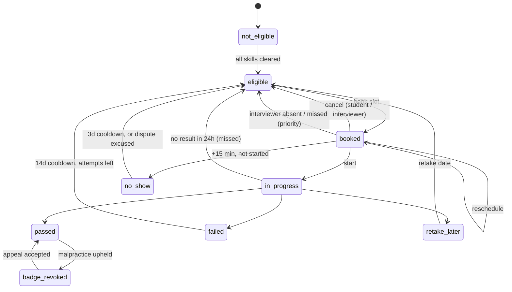

# GRIT Interview Scheduling — Design Write-up

**Scope.** Students who clear every skill for a Track Badge book a live interview from their dashboard. Interviewers publish availability and record **pass / fail / retake later**. The interview team sees who has and hasn't booked, and can nullify a badge if malpractice is found later. Prototype: React + FastAPI + Postgres (see `README.md`).

## 1. States — a student's journey for one badge

One `interview_journeys` row exists per *(student, badge)*. A single service, `state_machine.py`, is the only code that writes its status. Every change is checked against an allow-list and logged to `interview_events`.

| State | Meaning | Moves to → (trigger) |
|---|---|---|
| `not_eligible` | Skills for the badge not all cleared | → `eligible` when the last required skill is cleared |
| `eligible` | Can book; no live booking | → `booked` when the student books a slot |
| `booked` | Slot reserved | → `booked` on reschedule (≥12h before, max 2; free if the interviewer moved it) · → `eligible` when the student cancels (≥12h before) · → `booked`/`eligible` on an **emergency change** inside 12h (reason required; team approves → no attempt, rejects → counts as an attempt) · → `booked` when the interviewer moves it to another of their slots (reason required) · → `eligible` + **priority** when the interviewer cancels or takes leave (reason required) · → `in_progress` when the interviewer starts it (from 10 min before) · → `no_show` (only from 15 min after the start, with a note) · → `eligible` + **priority** if the student reports the interviewer never joined (from 15 min after the start), or the interview is marked **missed** (still not started 15 min after the slot) |
| `in_progress` | Interview live | → `passed` / `failed` / `retake_later` when the outcome is recorded (not before the slot starts) · → `eligible` + priority (missed) if no result is recorded within 24h. A no-show can't be marked once started. |
| `retake_later` | "Not ready yet" — **no attempt used** | → `eligible` on the interviewer-chosen date (1–60 days) |
| `failed` | Didn't clear — uses 1 of 3 attempts | → `eligible` after 14 days if attempts remain; otherwise final for the season |
| `no_show` | Student didn't join — uses an attempt | → `eligible` after 3 days if attempts remain. The student can **dispute** it within 48h; the team excuses it (→ `eligible` at once, attempt refunded) or rejects it with a reason |
| `passed` | Badge awarded, shown on profile | → `badge_revoked` when a malpractice flag is upheld |
| `badge_revoked` | Badge nullified | → `passed` only if an appeal is accepted (flag dismissed) |

Cooldowns are stored as `eligible_again_at` and applied **lazily** whenever the journey is read or acted on, so no cron job is needed.

## 2. Edge cases handled

- **Two students, one slot.** The journey row and then the slot row are locked with `SELECT … FOR UPDATE`. Exactly one booking wins and the other gets *"That slot was just taken — pick another one."* A partial unique index on `interviews(slot_id) WHERE status IN (scheduled, in_progress)` is a second guard. Covered by a 5-thread test.
- **One live booking per badge.** A second partial unique index on `journey_id` enforces this. A student may hold bookings for *different* badges.
- **Slots in the past or too soon.** Slots are bookable only ≥ **30 min** ahead, and the Book page says so. The interviewer sees those slots labelled *Too soon to book*, and unbooked past slots as *Expired*, so availability never looks bookable when it isn't. Changes close **12h** before the interview, with a clear message.
- **Interviewer unavailable.** The interviewer can **reschedule** an interview to another of their own open slots or **cancel** it, both with a required reason; blocking a booked slot or taking a day off with bookings also asks for one. The student is told why (no attempt used, **priority** to rebook after a cancel) and the team leads are notified. After an interviewer move the old time is blocked and the student may reschedule or cancel for free until the interview starts.
- **Student emergency inside 12 hours.** Normal changes close 12h before (and after 2 reschedules). After that, the student can make one **emergency change** per attempt until the interview starts: move to a new slot or cancel, with a reason (20+ characters). It happens immediately, so the interviewer's slot is freed and they're told; it then waits in *Interviews → Emergency changes*. Approved → no attempt used. Rejected (reason required) → it counts as an attempt; if that was the last attempt, any upcoming booking is cancelled and booking closes.
- **Racing changes.** Every change locks the interview row first, so a student change and an interviewer cancel at the same moment can't both apply. Interviewer moves/cancels also carry the slot they were looking at; if the student moved it meanwhile, the request is refused with "refresh and check again" (covered by two-thread tests).
- **Availability edits.** Overlapping windows are rejected. Removing a window deletes only *open* future slots; booked and blocked slots are never silently removed. Times are stored in UTC and shown in IST.
- **Interview-day timeline.** One module (`interview_rules.py`) owns every timing rule, and the API sends each interview's allowed actions (and when a blocked one opens) to the UI, so buttons and server never disagree:
  `start−10m` *Mark as started* opens · `start` *Record outcome* opens · `start+15m` *No-show* (interviewer) and *My interviewer hasn't joined* (student) open · `end+15m` an interview nobody started is marked **missed**.
- **Who didn't turn up.** *Student absent:* from 15 min after the start the interviewer can mark a no-show, with a note for the team (uses an attempt). It's refused once the interview was started — a started interview means the student was there. *Interviewer absent:* from 15 min after the start the student reports it; no attempt is used, the student is prioritised and the interviewer is notified. *Nobody turned up:* a background job marks the interview **missed** 15 min after the slot (24h if it was started but no result was recorded); no attempt is used and the student, interviewer and team leads are notified. Whoever acts first wins: the interview row is locked, and the other action is refused (covered by a two-thread test).
- **Wrongly marked absent.** The meeting link (Jitsi) gives no attendance data, so the guard is process: the 15-min rule, a required interviewer note, and a student **dispute** within 48h. Disputes land in a *Disputed* queue showing both sides' notes; the team excuses (attempt refunded) or rejects with a reason the student sees.
- **Reminders.** A background job sends the student an in-app reminder 24h and 1h before, and the interviewer one 1h before. Each is sent exactly once (claimed with `SKIP LOCKED`, safe with several workers), skipped if the booking was made inside that window, and reset on reschedule.
- **Outcome integrity.** Only the assigned interviewer can record an outcome, once, from the slot's start until 24h after it. Fail and retake require ≥20 characters of feedback, and retake requires a date. Internal notes are never shown to students.
- **Attempts.** Max 3 per badge per season. Fail and no-show use an attempt; retake-later and interviewer cancellations don't. After the last attempt the student sees a final message with a support route.
- **Malpractice after a pass.** An interviewer can report a concern (pending review), and a team lead either **nullifies the badge directly** or raises a flag and upholds it later. Either way the badge is revoked, the student is notified with the reason, and an audit event is logged. Dismissing an upheld flag (an appeal) reinstates the badge. A student can have only one open flag per badge.
- **Accounts.** Duplicate emails are rejected (case-insensitive). Every API checks role and ownership.

**Assumptions / open questions:**
- Interviewers pick their tracks (≥1) at signup and can change them; removing a track keeps existing bookings.
- 30-minute slots, a 3-attempt season limit, and 14-/3-day cooldowns are config values (`core/config.py`), not product decisions yet.
- Skill clears come from the existing contest system. The interview team can also record or correct them in **Student records**, and can reopen booking early, with a reason saved to the audit trail.
- If a skill clear is revoked *while booked*, the booking is honoured. Should it be cancelled?
- Signup lets anyone pick any role **for the demo only**. In production, roles would be assigned by the GRIT team.
- Video uses a generated Jitsi link; production would use the existing meeting tool. Messages and reminders go to the in-app inbox (bell, every role); email/WhatsApp delivery would plug into the same `notify()` call.

## 3. Data model (Postgres)

| Table | Key fields | Notes |
|---|---|---|
| `users` | id, name, email ⚑unique, password_hash, role (`student/interviewer/admin`), college | bcrypt hashes, JWT auth |
| `badges` | id, slug, name, max_attempts, interview_minutes | A Track Badge |
| `skills`, `badge_skills` | badge_id+skill_id PK, position | Many-to-many: SQL counts for Backend *and* Data Analyst |
| `student_skill_clears` | student_id+skill_id PK, cleared_at | Feeds eligibility |
| `interview_journeys` | id, student_id, badge_id ⚑unique pair, **status**, attempts_used, reschedules_used, eligible_since, eligible_again_at, priority_rebook, last_nudged_at | The state machine's row |
| `interview_events` | journey_id, from_status, to_status, actor_id, reason, created_at | Audit trail / student timeline |
| `interviewer_badges` | interviewer_id+badge_id PK | Tracks an interviewer can take; only their slots are offered for those badges |
| `availability_windows` | interviewer_id, weekday *xor* specific_date, start_time, end_time | Interviewer's rules (IST) |
| `slots` | interviewer_id, start_at ⚑unique pair, end_at, status (`open/booked/blocked`) | 30-min blocks for the next 14 days |
| `interviews` | journey_id, slot_id, student_id, interviewer_id, badge_id, attempt_no, status (`scheduled/in_progress/completed/no_show/cancelled_*/interviewer_absent/missed/excused`), meeting_link, cancel_reason, no_show_note, disputed_at, dispute_reason, dispute_resolution, moved_by_interviewer_at, move_reason, reminded_day_before_at, reminded_hour_before_at | Partial unique indexes on slot and on journey |
| `change_requests` | interview_id, journey_id, student_id, reason, attempt_no, from_start_at, to_start_at (null = cancelled), status (`pending/approved/rejected`), resolved_by, resolution_note | Student emergency changes; one per attempt |
| `interview_outcomes` | interview_id PK, result (`pass/fail/retake_later`), scores JSON (3-item rubric, 1–5), feedback_to_student, internal_notes, retake_after, recorded_by | One per interview |
| `student_badges` | student_id+badge_id ⚑unique, interview_id, status (`active/revoked`), revoked_at, revoke_reason | What the profile shows |
| `malpractice_flags` | student_id, badge_id, reason, evidence_url, resolution (`pending/upheld/dismissed`), flagged_by, resolved_by | Drives revocation |
| `notifications` | user_id, kind, title, body, tone, read_at | The student inbox |

All statuses are stored as varchar enums (no Postgres enum migrations). The schema is created with an Alembic migration.

## 4. The three student messages (exact copy)

1. **Booking confirmed:** *"You're booked! Your Frontend Developer badge interview is on Fri, 13 Nov at 4:30 PM IST with Priya Sharma. Join from your dashboard 5 minutes early. Need to change it? You can reschedule or cancel up to 12 hours before."*
2. **Passed:** *"Congratulations — you passed! Your Frontend Developer Track Badge is now live on your GRIT profile. Your interviewer's feedback is on your dashboard."*
3. **Retake later:** *"You're almost there. Your interviewer suggested a retake for the Frontend Developer badge. Review the feedback on your dashboard — you can book your next interview from 20 Nov. This won't count against you."*

All three are generated in `backend/app/services/messages.py`, along with the fail, no-show, interviewer-cancelled, reminder and revoked messages.

## 5. Screens (prototype)

- **Student:** Home (one card per badge, a variant for every state, a progress stepper and an inbox), Book (month calendar, IST time chips, confirm), Interview detail (timeline), My badges / profile.
- **Interviewer:** Today's schedule (start, no-show, **record outcome** with rubric, report malpractice), **Week calendar**, Availability (tracks, weekly hours, extra dates, a 14-day slot grid to block or reopen slots, take day off), **Booking status**, History.
- **Interview team leads (admin):** Overview, **Calendar** (all interviewers, filterable), **Interviewers** (tracks, weekly hours, load), **Booking status** (eligible students with a Booked / Not booked filter, days waiting, priority, bulk reminder), **Student records** (skill clears, early rebooking), All interviews, **Malpractice** (interviewer reports, nullify badge, flag → uphold → appeal).
- **Before/after (`/showcase`):** student home booked→passed, booked→retake, booked→failed; profile before→passed→revoked; interviewer row live→recorded. Built from the same production components.
